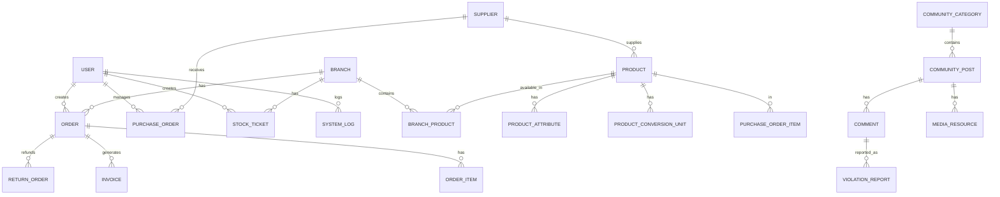

# Database Guide for MEP Management System

## 1. Tổng quan
Project này dùng **Entity Framework Core + PostgreSQL**. File trung tâm để hiểu toàn bộ schema là:
- [Models/MEPDatabaseContext.cs](Models/MEPDatabaseContext.cs)
- Các file entity trong thư mục [Models](Models)

`MEPDatabaseContext` định nghĩa tất cả `DbSet<T>` và cấu hình:
- tên bảng thực tế trên DB
- khóa chính
- index/unique constraint
- foreign key và cascade behavior

> Lưu ý: guide này đã bao gồm tên các bảng chính và quan hệ, nhưng chưa liệt kê đầy đủ từng cột và kiểu dữ liệu. Phần sau sẽ bổ sung để bạn có thể tra nhanh khi code.

> Nếu bạn chỉ cần đọc 1 điểm khởi đầu, hãy đọc file context trước, sau đó đọc từng entity class tương ứng.

---

## 2. Cách đọc schema nhanh
Mỗi entity thường có 2 phần:
1. **Properties**: cột dữ liệu chính
2. **Navigation properties**: quan hệ với entity khác

Ví dụ:
- `Order` có `BranchId`, `CustomerId`, `UserId`, `TotalAmount`, `Status`
- `Order` cũng có navigation `Branch`, `Customer`, `User`, `OrderItems`, `Invoices`, `ReturnOrders`

---

## 3. Các nhóm bảng chính

### A. Hệ thống và phân quyền
| Table | Mục đích chính |
|---|---|
| `users` | Người dùng hệ thống (staff, admin, owner...) |
| `roles` | Vai trò |
| `permissions` | Quyền hạn |
| `user_roles` | Quan hệ many-to-many giữa user và role |
| `system_logs` | Nhật ký hệ thống |
| `system_configs` | Cấu hình hệ thống |
| `system_notifications` | Thông báo gửi cho người dùng |
| `store_approvals` | Duyệt hồ sơ cửa hàng |

### B. Cửa hàng / chi nhánh
| Table | Mục đích chính |
|---|---|
| `branches` | Chi nhánh |
| `staff_assignments` | Gán nhân viên cho chi nhánh |
| `branch_products` | Sản phẩm có ở từng chi nhánh (inventory theo chi nhánh) |
| `stock_tickets` | Phiếu kiểm kho / điều chỉnh kho |
| `stock_ticket_items` | Chi tiết từng phiếu kiểm kho |

### C. Sản phẩm và nhà cung cấp
| Table | Mục đích chính |
|---|---|
| `products` | Sản phẩm tổng |
| `product_attributes` | Thuộc tính của sản phẩm |
| `product_conversion_units` | Đơn vị quy đổi sản phẩm |
| `suppliers` | Nhà cung cấp |
| `supplier_ratings` | Đánh giá nhà cung cấp |
| `supplier_payments` | Thanh toán cho nhà cung cấp |

### D. Đơn hàng và bán hàng
| Table | Mục đích chính |
|---|---|
| `customers` | Khách hàng |
| `orders` | Đơn bán hàng |
| `order_items` | Chi tiết đơn hàng |
| `invoices` | Hóa đơn |
| `invoice_items` | Chi tiết hóa đơn |
| `return_orders` | Đơn trả hàng |
| `return_items` | Chi tiết đơn trả hàng |

### E. Mua hàng / nhập hàng
| Table | Mục đích chính |
|---|---|
| `purchase_orders` | Đơn đặt hàng nhà cung cấp |
| `purchase_order_items` | Chi tiết đơn đặt hàng |

### F. Cộng đồng / nội dung
| Table | Mục đích chính |
|---|---|
| `community_categories` | Danh mục bài viết cộng đồng |
| `community_posts` | Bài viết cộng đồng |
| `comments` | Bình luận |
| `media_resources` | Ảnh/video/file đính kèm |
| `violation_reports` | Báo cáo vi phạm nội dung |

### G. Xác thực / OTP
| Table | Mục đích chính |
|---|---|
| `otp_verifications` | OTP cho xác thực email / đăng nhập |

---

## 4. Danh sách bảng và kiểu dữ liệu chính

Phần này mô tả các entity chính trong project. Kiểu dữ liệu dưới đây là kiểu dùng trong C#/EF Core mapping, và có thể tương ứng với kiểu Postgres trong context.

### 4.0 Tất cả class trong project

Dưới đây là danh sách đầy đủ các class model (bao gồm cả class `MEPDatabaseContext` là file trung tâm của schema):

| Class | Bảng / mục đích |
|---|---|
| `Branch` | Chi nhánh |
| `BranchProduct` | Sản phẩm theo từng chi nhánh |
| `Comment` | Bình luận của người dùng trên bài post |
| `CommunityCategory` | Danh mục bài viết cộng đồng |
| `CommunityPost` | Bài viết cộng đồng |
| `Customer` | Khách hàng |
| `Invoice` | Hóa đơn bán hàng |
| `InvoiceItem` | Chi tiết dòng hóa đơn |
| `MediaResource` | File ảnh/video đính kèm |
| `MEPDatabaseContext` | Context EF Core, định nghĩa schema và mapping |
| `Order` | Đơn hàng bán |
| `OrderItem` | Chi tiết đơn hàng |
| `OtpVerification` | OTP xác thực |
| `Permission` | Quyền hạn |
| `Product` | Sản phẩm gốc |
| `ProductAttribute` | Thuộc tính của sản phẩm |
| `ProductConversionUnit` | Đơn vị quy đổi sản phẩm |
| `PurchaseOrder` | Đơn đặt hàng nhập |
| `PurchaseOrderItem` | Chi tiết đơn đặt hàng nhập |
| `ReturnItem` | Chi tiết hàng trả |
| `ReturnOrder` | Đơn trả hàng |
| `Role` | Vai trò |
| `StaffAssignment` | Phân công nhân viên cho chi nhánh |
| `StockTicket` | Phiếu kiểm kho |
| `StockTicketItem` | Chi tiết phiếu kiểm kho |
| `StoreApproval` | Đơn duyệt cửa hàng |
| `Supplier` | Nhà cung cấp |
| `SupplierPayment` | Thanh toán với nhà cung cấp |
| `SupplierRating` | Đánh giá nhà cung cấp |
| `SystemConfig` | Cấu hình hệ thống |
| `SystemLog` | Nhật ký hoạt động |
| `SystemNotification` | Thông báo hệ thống |
| `User` | Người dùng hệ thống |
| `ViolationReport` | Báo cáo vi phạm nội dung |

### 4.1 Danh sách trường của từng class

> Ghi chú: phần này liệt kê các property chính trong từng class. Những property có tên kiểu `...Products`, `...Items`, `...Orders` thường là navigation property (liên kết sang bảng khác), còn các field như `UserId`, `OrderCode`, `CreatedAt` là trường dữ liệu thật.

#### `Branch`
- `BranchId`
- `BranchName`
- `Address`
- Navigation: `BranchProducts`, `Orders`, `StaffAssignments`, `StockTickets`, `SystemConfigs`

#### `BranchProduct`
- `BranchProductId`
- `BranchId`
- `ProductId`
- `CostPrice`
- `SellPrice`
- `ActualStock`
- `ReservedStock`
- `AvailableStock`
- `MinimumStock`
- `MaximumStock`
- `ShelfLocation`
- `IsActive`
- `DirectSale`
- `EstimatedOutAt`
- Navigation: `Branch`, `OrderItems`, `Product`, `ReturnItems`, `StockTicketItems`

#### `Comment`
- `CommentId`
- `PostId`
- `UserId`
- `CommentText`
- `CreatedAt`
- Navigation: `Post`, `User`, `ViolationReports`

#### `CommunityCategory`
- `CategoryId`
- `CategoryName`
- `Description`
- `IsArchived`
- `SortOrder`
- `Slug`
- `ParentId`
- Navigation: `Parent`, `Children`, `CommunityPosts`

#### `CommunityPost`
- `PostId`
- `CategoryId`
- `UserId`
- `Title`
- `Content`
- `Status`
- `IsPinned`
- `ViewCount`
- `GroupBuyingTarget`
- `GroupBuyingPrice`
- `CreatedAt`
- Navigation: `Category`, `Comments`, `MediaResources`, `User`, `ViolationReports`

#### `Customer`
- `CustomerId`
- `CustomerName`
- `PhoneNumber`
- `Email`
- `Address`
- `LoyaltyPoints`
- `DebtLimit`
- `CurrentDebt`
- `Status`
- `CreatedAt`
- Navigation: `Orders`

#### `Invoice`
- `InvoiceId`
- `InvoiceCode`
- `OrderId`
- `UserId`
- `TotalAmount`
- `PaymentMethod`
- `Status`
- `Note`
- `CreatedAt`
- Navigation: `InvoiceItems`, `Order`, `User`

#### `InvoiceItem`
- `InvoiceItemId`
- `InvoiceId`
- `BranchProductId`
- `Quantity`
- `SellPrice`
- Navigation: `BranchProduct`, `Invoice`

#### `MediaResource`
- `MediaId`
- `ProductId`
- `PostId`
- `MediaUrl`
- `MediaType`
- `IsPrimary`
- `CreatedAt`
- Navigation: `Post`, `Product`

#### `Order`
- `OrderId`
- `OrderCode`
- `BranchId`
- `CustomerId`
- `UserId`
- `TotalAmount`
- `DiscountAmount`
- `TaxAmount`
- `PaymentMethod`
- `Status`
- `Note`
- `CreatedAt`
- Navigation: `Branch`, `Customer`, `Invoices`, `OrderItems`, `ReturnOrders`, `User`

#### `OrderItem`
- `OrderItemId`
- `OrderId`
- `BranchProductId`
- `Quantity`
- `SellPrice`
- Navigation: `BranchProduct`, `Order`

#### `OtpVerification`
- `OtpId`
- `Email`
- `OtpCode`
- `Purpose`
- `ExpiredAt`
- `IsUsed`
- `CreatedAt`

#### `Permission`
- `PermissionId`
- `PermissionCode`
- `PermissionName`
- Navigation: `Roles`

#### `Product`
- `ProductId`
- `ProductCode`
- `ProductName`
- `Barcode`
- `BaseUnit`
- `Specification`
- `ItemType`
- `BrandName`
- `CategoryName`
- `SupplierId`
- `Weight`
- `WeightUnit`
- `Width`
- `Length`
- `Height`
- `SizeUnit`
- `SalesChannelLinked`
- `Status`
- `CreatedAt`
- Navigation: `BranchProducts`, `MediaResources`, `ProductAttributes`, `ProductConversionUnits`, `PurchaseOrderItems`, `Supplier`

#### `ProductAttribute`
- `AttributeId`
- `ProductId`
- `AttributeName`
- `AttributeValue`
- Navigation: `Product`

#### `ProductConversionUnit`
- `ConversionId`
- `ProductId`
- `UnitName`
- `ConvertValue`
- `Price`
- `DirectSale`
- Navigation: `Product`

#### `PurchaseOrder`
- `PurchaseOrderId`
- `OrderCode`
- `SupplierId`
- `UserId`
- `TotalAmount`
- `Status`
- `ApprovedBy`
- `ApprovedAt`
- `ExpectedDeliveryDate`
- `Notes`
- `CreatedAt`
- Navigation: `PurchaseOrderItems`, `Supplier`, `User`, `ApprovedByUser`

#### `PurchaseOrderItem`
- `PoItemId`
- `PurchaseOrderId`
- `ProductId`
- `Quantity`
- `UnitPrice`
- Navigation: `Product`, `PurchaseOrder`

#### `ReturnItem`
- `ReturnItemId`
- `ReturnOrderId`
- `BranchProductId`
- `Quantity`
- `RefundAmount`
- `Reason`
- Navigation: `BranchProduct`, `ReturnOrder`

#### `ReturnOrder`
- `ReturnOrderId`
- `ReturnCode`
- `OrderId`
- `UserId`
- `RefundAmount`
- `RefundMethod`
- `Status`
- `Note`
- `CreatedAt`
- Navigation: `Order`, `ReturnItems`, `User`

#### `Role`
- `RoleId`
- `RoleName`
- `Description`
- `IsSystem`
- Navigation: `Permissions`, `Users`

#### `StaffAssignment`
- `AssignmentId`
- `UserId`
- `BranchId`
- `AssignedAt`
- Navigation: `Branch`, `User`

#### `StockTicket`
- `StockTicketId`
- `TicketCode`
- `BranchId`
- `UserId`
- `TicketType`
- `Status`
- `Notes`
- `CreatedAt`
- Navigation: `Branch`, `StockTicketItems`, `User`

#### `StockTicketItem`
- `TicketItemId`
- `StockTicketId`
- `BranchProductId`
- `SystemQuantity`
- `ActualQuantity`
- `Discrepancy`
- Navigation: `BranchProduct`, `StockTicket`

#### `StoreApproval`
- `ApprovalId`
- `UserId`
- `StoreName`
- `BusinessLicense`
- `TaxCode`
- `StoreAddress`
- `DocumentUrls`
- `Status`
- `RejectReason`
- `ReviewedBy`
- `ReviewedAt`
- `CreatedAt`
- Navigation: `User`, `ReviewedByUser`

#### `Supplier`
- `SupplierId`
- `SupplierName`
- `ContactPhone`
- `ContactEmail`
- `ContactPerson`
- `TaxCode`
- `GroupName`
- `BankAccount`
- `BankName`
- `Website`
- `Notes`
- `Address`
- `Status`
- `CreatedAt`
- `AverageRating`
- `RatingCount`
- `LastRatedAt`
- Navigation: `Products`, `PurchaseOrders`, `SupplierRatings`

#### `SupplierPayment`
- `PaymentId`
- `SupplierId`
- `PurchaseOrderId`
- `Amount`
- `PaymentDate`
- `PaymentMethod`
- `ReferenceCode`
- `Note`
- `RecordedBy`
- `CreatedAt`
- `IsDeleted`
- Navigation: `Supplier`, `PurchaseOrder`, `RecordedByUser`

#### `SupplierRating`
- `RatingId`
- `SupplierId`
- `PurchaseOrderId`
- `QualityScore`
- `DeliveryScore`
- `PriceScore`
- `ServiceScore`
- `OverallRating`
- `Comment`
- `RatedBy`
- `RatedAt`
- Navigation: `Supplier`, `PurchaseOrder`, `RatedByUser`

#### `SystemConfig`
- `ConfigId`
- `BranchId`
- `ConfigKey`
- `ConfigValue`
- Navigation: `Branch`

#### `SystemLog`
- `LogId`
- `UserId`
- `Action`
- `TableName`
- `EntityType`
- `EntityId`
- `Description`
- `IpAddress`
- `UserAgent`
- `Level`
- `Source`
- `Timestamp`
- Navigation: `User`

#### `SystemNotification`
- `NotificationId`
- `Title`
- `Content`
- `Target`
- `IsUrgent`
- `ScheduledAt`
- `SentAt`
- `Status`
- `CreatedBy`
- `CreatedAt`
- Navigation: `CreatedByUser`

#### `User`
- `UserId`
- `Username`
- `PasswordHash`
- `FullName`
- `IsActive`
- `CreatedAt`
- `Email`
- `PhoneNumber`
- `IsVerified`
- `Status`
- `SuspendedUntil`
- `SubscriptionPlan`
- Navigation: `Comments`, `CommunityPosts`, `Invoices`, `Orders`, `PurchaseOrders`, `ReturnOrders`, `StaffAssignments`, `StockTickets`, `SystemLogs`, `ViolationReports`, `Roles`, `SystemNotifications`, `StoreApprovals`

#### `ViolationReport`
- `ReportId`
- `PostId`
- `CommentId`
- `UserId`
- `Reason`
- `Status`
- `ResolvedBy`
- `ResolvedAt`
- `AdminNote`
- `CreatedAt`
- Navigation: `Comment`, `Post`, `User`, `ResolvedByUser`

### 4.2 Hệ thống / người dùng / phân quyền

| Bảng | Entity | Kiểu dữ liệu chính |
|---|---|---|
| `users` | `User` | `Guid UserId`, `string Username`, `string PasswordHash`, `string FullName`, `string Email`, `string? PhoneNumber`, `bool IsVerified`, `string? Status`, `DateTime? CreatedAt`, `DateTime? SuspendedUntil`, `string? SubscriptionPlan` |
| `roles` | `Role` | `Guid RoleId`, `string RoleName`, `string? Description`, `short? IsSystem` |
| `permissions` | `Permission` | `Guid PermissionId`, `string PermissionCode`, `string PermissionName` |
| `user_roles` | join table | `Guid UserId`, `Guid RoleId` |
| `role_permissions` | join table | `Guid RoleId`, `Guid PermissionId` |
| `system_logs` | `SystemLog` | `Guid LogId`, `Guid? UserId`, `string? Action`, `string? TableName`, `string? EntityType`, `string? EntityId`, `string? Description`, `string? IpAddress`, `string? UserAgent`, `string? Level`, `string? Source`, `DateTime? Timestamp` |
| `system_configs` | `SystemConfig` | `Guid ConfigId`, `Guid? BranchId`, `string ConfigKey`, `string? ConfigValue` |
| `system_notifications` | `SystemNotification` | `Guid NotificationId`, `string? Title`, `string Content`, `string? Target`, `bool IsUrgent`, `DateTime? ScheduledAt`, `DateTime? SentAt`, `string Status`, `Guid? CreatedBy`, `DateTime? CreatedAt` |
| `store_approvals` | `StoreApproval` | `Guid ApprovalId`, `Guid UserId`, `string StoreName`, `string? BusinessLicense`, `string? TaxCode`, `string? StoreAddress`, `string? DocumentUrls`, `string Status`, `string? RejectReason`, `Guid? ReviewedBy`, `DateTime? ReviewedAt`, `DateTime? CreatedAt` |

### 4.2 Chi nhánh / kho

| Bảng | Entity | Kiểu dữ liệu chính |
|---|---|---|
| `branches` | `Branch` | `Guid BranchId`, `string BranchName`, `string? Address` |
| `staff_assignments` | `StaffAssignment` | `Guid AssignmentId`, `Guid UserId`, `Guid BranchId`, `DateTime? AssignedAt` |
| `branch_products` | `BranchProduct` | `Guid BranchProductId`, `Guid BranchId`, `Guid ProductId`, `decimal? CostPrice`, `decimal? SellPrice`, `decimal? ActualStock`, `decimal? ReservedStock`, `decimal? AvailableStock`, `decimal? MinimumStock`, `decimal? MaximumStock`, `string? ShelfLocation`, `short? IsActive`, `short? DirectSale`, `DateTime? EstimatedOutAt` |
| `stock_tickets` | `StockTicket` | `Guid StockTicketId`, `string? TicketCode`, `Guid BranchId`, `Guid UserId`, `string? TicketType`, `string? Status`, `string? Notes`, `DateTime? CreatedAt` |
| `stock_ticket_items` | `StockTicketItem` | `Guid TicketItemId`, `Guid StockTicketId`, `Guid BranchProductId`, `decimal? SystemQuantity`, `decimal? ActualQuantity`, `decimal? Discrepancy` |

### 4.3 Sản phẩm / nhà cung cấp

| Bảng | Entity | Kiểu dữ liệu chính |
|---|---|---|
| `products` | `Product` | `Guid ProductId`, `string ProductCode`, `string ProductName`, `string? Barcode`, `string BaseUnit`, `string? Specification`, `string? ItemType`, `string? BrandName`, `string? CategoryName`, `Guid? SupplierId`, `decimal? Weight`, `string? WeightUnit`, `decimal? Width`, `decimal? Length`, `decimal? Height`, `string? SizeUnit`, `short? SalesChannelLinked`, `short? Status`, `DateTime? CreatedAt` |
| `product_attributes` | `ProductAttribute` | `Guid AttributeId`, `Guid ProductId`, `string? AttributeName`, `string? AttributeValue` |
| `product_conversion_units` | `ProductConversionUnit` | `Guid ConversionId`, `Guid ProductId`, `string? UnitName`, `decimal? ConvertValue`, `decimal? Price`, `short? DirectSale` |
| `suppliers` | `Supplier` | `Guid SupplierId`, `string SupplierName`, `string? ContactPhone`, `string? ContactEmail`, `string? ContactPerson`, `string? TaxCode`, `string? GroupName`, `string? BankAccount`, `string? BankName`, `string? Website`, `string? Notes`, `string? Address`, `short? Status`, `DateTime? CreatedAt`, `decimal? AverageRating`, `int? RatingCount`, `DateTime? LastRatedAt` |
| `supplier_ratings` | `SupplierRating` | `Guid RatingId`, `Guid SupplierId`, `Guid? PurchaseOrderId`, `decimal? QualityScore`, `decimal? DeliveryScore`, `decimal? PriceScore`, `decimal? ServiceScore`, `decimal? OverallRating`, `string? Comment`, `Guid? RatedBy`, `DateTime? RatedAt` |
| `supplier_payments` | `SupplierPayment` | `Guid PaymentId`, `Guid SupplierId`, `Guid? PurchaseOrderId`, `decimal Amount`, `DateTime? PaymentDate`, `string? PaymentMethod`, `string? ReferenceCode`, `string? Note`, `Guid? RecordedBy`, `DateTime? CreatedAt`, `short IsDeleted` |

### 4.4 Bán hàng / đơn hàng

| Bảng | Entity | Kiểu dữ liệu chính |
|---|---|---|
| `customers` | `Customer` | `Guid CustomerId`, `string CustomerName`, `string? PhoneNumber`, `string? Email`, `string? Address`, `int? LoyaltyPoints`, `decimal? DebtLimit`, `decimal? CurrentDebt`, `short? Status`, `DateTime? CreatedAt` |
| `orders` | `Order` | `Guid OrderId`, `string OrderCode`, `Guid BranchId`, `Guid? CustomerId`, `Guid UserId`, `decimal TotalAmount`, `decimal? DiscountAmount`, `decimal? TaxAmount`, `string? PaymentMethod`, `string Status`, `string? Note`, `DateTime? CreatedAt` |
| `order_items` | `OrderItem` | `Guid OrderItemId`, `Guid OrderId`, `Guid BranchProductId`, `decimal? Quantity`, `decimal? SellPrice` |
| `invoices` | `Invoice` | `Guid InvoiceId`, `string InvoiceCode`, `Guid OrderId`, `Guid UserId`, `decimal? TotalAmount`, `string? PaymentMethod`, `string? Status`, `string? Note`, `DateTime? CreatedAt` |
| `invoice_items` | `InvoiceItem` | `Guid InvoiceItemId`, `Guid InvoiceId`, `Guid BranchProductId`, `decimal? Quantity`, `decimal? SellPrice` |
| `return_orders` | `ReturnOrder` | `Guid ReturnOrderId`, `string ReturnCode`, `Guid OrderId`, `Guid UserId`, `decimal? RefundAmount`, `string? RefundMethod`, `string? Status`, `string? Note`, `DateTime? CreatedAt` |
| `return_items` | `ReturnItem` | `Guid ReturnItemId`, `Guid ReturnOrderId`, `Guid BranchProductId`, `decimal? Quantity`, `decimal? RefundAmount`, `string? Reason` |

### 4.5 Mua hàng / nhập hàng

| Bảng | Entity | Kiểu dữ liệu chính |
|---|---|---|
| `purchase_orders` | `PurchaseOrder` | `Guid PurchaseOrderId`, `string OrderCode`, `Guid SupplierId`, `Guid UserId`, `decimal? TotalAmount`, `string? Status`, `Guid? ApprovedBy`, `DateTime? ApprovedAt`, `DateTime? ExpectedDeliveryDate`, `string? Notes`, `DateTime? CreatedAt` |
| `purchase_order_items` | `PurchaseOrderItem` | `Guid PoItemId`, `Guid PurchaseOrderId`, `Guid ProductId`, `decimal? Quantity`, `decimal? UnitPrice` |

### 4.6 Cộng đồng / nội dung

| Bảng | Entity | Kiểu dữ liệu chính |
|---|---|---|
| `community_categories` | `CommunityCategory` | `Guid CategoryId`, `string CategoryName`, `string? Description`, `bool IsArchived`, `int SortOrder`, `string? Slug`, `Guid? ParentId` |
| `community_posts` | `CommunityPost` | `Guid PostId`, `Guid CategoryId`, `Guid UserId`, `string Title`, `string Content`, `string Status`, `short? IsPinned`, `int? ViewCount`, `decimal? GroupBuyingTarget`, `decimal? GroupBuyingPrice`, `DateTime? CreatedAt` |
| `comments` | `Comment` | `Guid CommentId`, `Guid PostId`, `Guid UserId`, `string CommentText`, `DateTime? CreatedAt` |
| `media_resources` | `MediaResource` | `Guid MediaId`, `Guid? ProductId`, `Guid? PostId`, `string? MediaUrl`, `string? MediaType`, `short? IsPrimary`, `DateTime? CreatedAt` |
| `violation_reports` | `ViolationReport` | `Guid ReportId`, `Guid? PostId`, `Guid? CommentId`, `Guid UserId`, `string? Reason`, `string Status`, `Guid? ResolvedBy`, `DateTime? ResolvedAt`, `string? AdminNote`, `DateTime? CreatedAt` |

### 4.7 Xác thực / OTP

| Bảng | Entity | Kiểu dữ liệu chính |
|---|---|---|
| `otp_verifications` | `OtpVerification` | `Guid OtpId`, `string Email`, `string OtpCode`, `string? Purpose`, `DateTime? ExpiredAt`, `short? IsUsed`, `DateTime? CreatedAt` |

### 4.8 Ghi chú quan trọng về “tất cả bảng”
- Các bảng có entity riêng: tất cả các dòng trên đây.
- Các bảng join nhiều-nhiều không có entity riêng trong code nhưng vẫn tồn tại trong DB: `user_roles`, `role_permissions`.
- Nếu cần tra “tất cả cột thật” thì nên đọc luôn [Models/MEPDatabaseContext.cs](Models/MEPDatabaseContext.cs) vì đây là nơi định nghĩa tên bảng, FK, constraint và index.

---

## 5. File cấu hình và kiến trúc dự án (Project Architecture)

MEP_Management_System/
│
├── AutoMapper/          # Các profile cấu hình ánh xạ DTO <-> Entity
├── Controllers/         # Điểm tiếp nhận HTTP Request (Chia theo cụm nghiệp vụ)
│   ├── AdminController/
│   ├── AuthenticationController/
│   └── InventoryController/
│       ├── Supplier/    # Nhóm quản lý nhà cung cấp
│       │   ├── SupplierController.cs
│       │   ├── SupplierDebtController.cs
│       │   ├── SupplierPaymentController.cs
│       │   └── SupplierRatingController.cs
│       └── ProductsController.cs
│
├── DTOs/                # Gồm các file *Request.cs và *Response.cs
├── Formatters/          # Định dạng dữ liệu đầu vào/đầu ra riêng (nếu có)
├── Migrations/          # Các file migration của EF Core
├── Models/              # Chứa MEPDatabaseContext.cs và các lớp Entity
├── Seed/                # Dữ liệu mẫu nạp vào DB khi khởi tạo
├── Services/            # Lớp xử lý Logic nghiệp vụ (Business Logic)
│
├── DATABASE_GUIDE.md    # File hướng dẫn trung tâm cho AI
├── Program.cs           # File cấu hình khởi chạy và DI pipeline
└── appsettings.json     # Cấu hình ConnectionString và JWT

### 5.2 Kiến trúc hiện tại
Project đang dùng kiến trúc **Controller + Service + DTO + EF Core Model**. Nói cách ngắn:
- `Controllers` nhận request HTTP
- `Services` xử lý nghiệp vụ
- `DTOs` là lớp trung gian giữa API và entity
- `Models` là schema database / EF entity
- `AutoMapper` dùng để map giữa entity và DTO

### 5.3 Program / Startup configuration
Trong [Program.cs](Program.cs), hệ thống đang đăng ký:
- EF Core với PostgreSQL (`UseNpgsql(...)`)
- Dependency Injection cho service và controller
- AutoMapper nếu có trong project
- JWT/Auth nếu có cấu hình trong pipeline

### 5.4 Gợi ý cho AI khi sinh code
- Nếu cần tạo API mới, ưu tiên tạo:
  1. DTO request/response
  2. Service method xử lý logic
  3. Controller endpoint
  4. Mapping trong AutoMapper (nếu dùng)
- Không nên expose trực tiếp entity ra API nếu chưa có DTO phù hợp.

---

## 6. Danh sách DTOs / Request / Response Models

### 6.1 Quy ước sử dụng DTO
Trong dự án này, nên phân biệt rõ:
- `*Request`: dữ liệu client gửi lên
- `*Response`: dữ liệu trả về cho client
- `DTO` dùng cho các object trung gian, không nên dùng entity trực tiếp ra API

### 6.2 Ví dụ quy ước nên dùng cho AI
- Tạo `Order`:
  - Request cần có: `BranchId`, `CustomerId`, `UserId`, `PaymentMethod`, `Note`, các dòng item (`OrderItems`)
  - Không nên yêu cầu client gửi `OrderId`, `CreatedAt`, `Status` nếu hệ thống tự sinh
- Tạo `PurchaseOrder`:
  - Request cần có: `SupplierId`, `UserId`, `ExpectedDeliveryDate`, `Notes`, danh sách item
- Tạo `StoreApproval`:
  - Request chỉ cần thông tin hồ sơ và tài liệu; `Status` và `ReviewedBy` do admin xử lý

### 6.3 Các DTO thường có thể dùng
- `CreateOrderRequest`
- `UpdateOrderRequest`
- `OrderResponse`
- `CreatePurchaseOrderRequest`
- `PurchaseOrderResponse`
- `UserLoginRequest` / `UserLoginResponse`
- `CreateProductRequest`
- `ProductResponse`

---

## 7. Logic xử lý trạng thái (State Machine / Status Workflow)

### 7.1 Quy tắc chung
Các trạng thái string thường dùng trong project gồm:
- `ACTIVE`, `INACTIVE`, `PENDING`, `COMPLETED`, `CANCELLED`, `APPROVED`, `REJECTED`, `DRAFT`

### 7.2 Workflow gợi ý cho từng nghiệp vụ

#### `Order`
- `PENDING` -> `PAID` -> `COMPLETED`
- Có thể có `CANCELLED` từ bất kỳ trạng thái nào nếu hợp lệ
- Không nên cho phép bỏ qua trực tiếp từ `PENDING` sang `COMPLETED`

#### `PurchaseOrder`
- `PENDING` -> `APPROVED` -> `RECEIVED` / `COMPLETED`
- Có thể có `CANCELLED`

#### `StoreApproval`
- `PENDING` -> `APPROVED` / `REJECTED`

#### `CommunityPost`
- `ACTIVE` / `DRAFT` / `ARCHIVED`

#### `ViolationReport`
- `PENDING` -> `RESOLVED`

### 7.3 Gợi ý validation cho AI
- API tạo đơn hàng không được cho phép client tự set `Status = COMPLETED` nếu chưa thanh toán
- API duyệt đơn phải kiểm tra quyền và trạng thái trước khi update
- Các trạng thái nên được validate bằng enum hoặc constant list thay vì string tự do

---

## 8. Quy tắc tính toán tự động (Business Rules)

### 8.1 Kho / tồn kho
Công thức thường dùng:
- `AvailableStock = ActualStock - ReservedStock`
- `ReservedStock` là số lượng giữ chỗ cho đơn hàng đang xử lý
- `ActualStock` là tồn thực tế được kiểm kê

### 8.2 Đơn hàng
Công thức kinh doanh gợi ý:
- `TotalAmount = Σ(Quantity × SellPrice) - DiscountAmount + TaxAmount`
- Nếu có điểm loyalty, logic cần kiểm tra xem có trừ tự động hay chỉ dùng để giảm giá riêng biệt

### 8.3 Nhà cung cấp / đánh giá
- `Supplier.AverageRating` và `RatingCount` có thể là snapshot từ `SupplierRating`
- Khi thêm đánh giá mới, nên cập nhật lại `AverageRating`, `RatingCount`, `LastRatedAt`

### 8.4 Hóa đơn / hoàn trả
- `Invoice.TotalAmount` nên bằng tổng tiền của các dòng hóa đơn
- `ReturnOrder.RefundAmount` nên dựa trên số lượng trả và giá gốc hoặc giá bán hiện tại

---

## 9. Cơ chế xác thực & phân quyền (Authentication & Authorization)

### 9.1 Xác thực
- Dự án có dùng JWT Token (nếu `JwtHelper.cs` được dùng trong auth flow)
- Nếu API cần login, hệ thống thường xác thực qua:
  - username/email + password
  - trả về token + thông tin user

### 9.2 Phân quyền
Các quyền nên được quản lý theo cơ chế:
- Role-based access (`Role`)
- Permission-based access (`PermissionCode`)

### 9.3 Ví dụ quy tắc quyền
- API duyệt cửa hàng (`store_approvals`) chỉ cho phép:
  - `Admin` hoặc user có permission `STORE_APPROVE`
- API cập nhật sản phẩm chỉ cho phép:
  - quản lý kho hoặc admin
- API xem báo cáo tài chính chỉ cho phép:
  - quản lý / kế toán / admin

### 9.4 Gợi ý cho AI
Khi tạo API mới, cần xác định:
- endpoint có cần token không
- endpoint cần role nào
- endpoint có cần permission cụ thể không
- có cần kiểm tra owner của record hay chỉ admin

---

## 10. Gợi ý cho việc sinh code bằng AI
1. Luôn bắt đầu từ model và context để biết schema.
2. Tạo DTO trước khi viết controller.
3. Có thể dùng service layer để gom logic nghiệp vụ.
4. Khi xử lý trạng thái, kiểm tra workflow bằng state machine.
5. Khi tính toán số lượng/tổng tiền, ưu tiên dùng service để tránh logic rơi vào controller.
6. Khi phát triển API mới, nên kiểm tra quyền và tránh expose entity trực tiếp.

### 4.1 Luồng người dùng và phân quyền
- `users` là trung tâm
- `roles` và `permissions` quản lý quyền
- `user_roles` kết nối user-role
- `system_logs` ghi mọi hành động quan trọng

### 4.2 Luồng sản phẩm và kho
- `products` là master sản phẩm
- `branch_products` là phiên bản sản phẩm ở từng chi nhánh
- `stock_tickets` quản lý kiểm kho
- `stock_ticket_items` là chi tiết từng dòng kiểm kho

### 4.3 Luồng mua hàng từ nhà cung cấp
- `suppliers` lưu nhà cung cấp
- `purchase_orders` là đơn đặt hàng
- `purchase_order_items` là chi tiết từng mặt hàng đặt mua
- `supplier_payments` theo dõi thanh toán cho đơn đặt hàng

### 4.4 Luồng bán hàng cho khách hàng
- `customers` lưu khách hàng
- `orders` là hóa đơn bán hàng chính
- `order_items` là từng sản phẩm trong đơn
- `invoices` là hóa đơn phát sinh từ order
- `invoice_items` là chi tiết dòng hóa đơn
- `return_orders` / `return_items` xử lý hoàn trả

### 4.5 Luồng cộng đồng
- `community_categories` -> `community_posts` -> `comments`
- `media_resources` có thể đính kèm vào post hoặc product
- `violation_reports` dùng để báo cáo comment/post

---

## 5. Quan hệ quan trọng

### Quan hệ 1-nhiều chính
- `Branch` 1-nhiều `BranchProduct`
- `Branch` 1-nhiều `Order`
- `Branch` 1-nhiều `StockTicket`
- `Product` 1-nhiều `BranchProduct`
- `Product` 1-nhiều `ProductAttribute`
- `Product` 1-nhiều `ProductConversionUnit`
- `Supplier` 1-nhiều `Product`
- `Supplier` 1-nhiều `PurchaseOrder`
- `Order` 1-nhiều `OrderItem`
- `Order` 1-nhiều `Invoice`
- `Order` 1-nhiều `ReturnOrder`
- `User` 1-nhiều `Order`
- `User` 1-nhiều `PurchaseOrder`
- `User` 1-nhiều `SystemLog`

### Quan hệ nhiều-nhiều
- `roles` <-> `permissions` qua bảng `role_permissions`
- `users` <-> `roles` qua bảng `user_roles`

### Quan hệ self-reference
- `community_categories` có `ParentId` để tạo cây danh mục con-cha

---

## 6. Các quy ước tên trong schema
- Khóa chính dùng kiểu `Guid` (UUID)
- Tên bảng thường là dạng snake_case, ví dụ `branch_products`
- Các cột khóa có dạng `*_id`
- Timestamp thường dùng cột `created_at`, `updated_at` (nếu có)
- Trạng thái thường dùng dạng string như `PENDING`, `ACTIVE`, `COMPLETED`
- Một số field boolean/short dùng số 0/1 thay vì true/false

---

## 7. Các file model nên đọc theo thứ tự
1. [Models/MEPDatabaseContext.cs](Models/MEPDatabaseContext.cs)  
   Nơi định nghĩa tất cả DbSet và cấu hình quan hệ.
2. [Models/User.cs](Models/User.cs)  
   Trung tâm identity / quyền / hoạt động người dùng.
3. [Models/Branch.cs](Models/Branch.cs)  
   Chi nhánh.
4. [Models/Product.cs](Models/Product.cs)  
   Sản phẩm gốc.
5. [Models/BranchProduct.cs](Models/BranchProduct.cs)  
   Sản phẩm theo từng chi nhánh.
6. [Models/Supplier.cs](Models/Supplier.cs)  
   Nhà cung cấp.
7. [Models/Order.cs](Models/Order.cs)  
   Đơn bán hàng.
8. [Models/PurchaseOrder.cs](Models/PurchaseOrder.cs)  
   Đơn nhập hàng.
9. [Models/CommunityPost.cs](Models/CommunityPost.cs)  
   Nội dung cộng đồng.

---

## 8. Sơ đồ quan hệ đơn giản

---

## 9. Gợi ý khi code
- Khi cần tra bảng nào đó, ưu tiên tìm entity class trước rồi xem context để biết foreign key.
- Nếu cần query theo nghiệp vụ, hãy bắt đầu từ entity chính rồi đi theo navigation property.
- Nếu cần hiểu luồng dữ liệu: `User -> Order -> Invoice` hoặc `Supplier -> PurchaseOrder -> PurchaseOrderItem -> Product`.

---

## 10. Tóm tắt nhanh
Nếu bạn muốn nhớ một câu ngắn để hiểu toàn bộ DB:
- `User` quản lý hệ thống,
- `Branch` và `Product` là nền tảng kho,
- `Order` / `Invoice` xử lý bán hàng,
- `PurchaseOrder` xử lý nhập hàng,
- `CommunityPost` / `Comment` xử lý cộng đồng.
